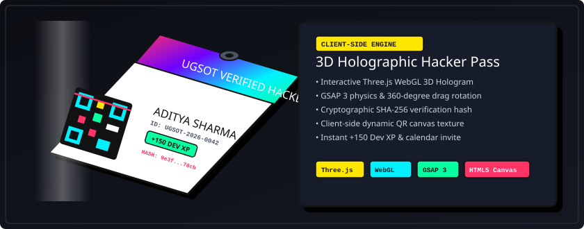
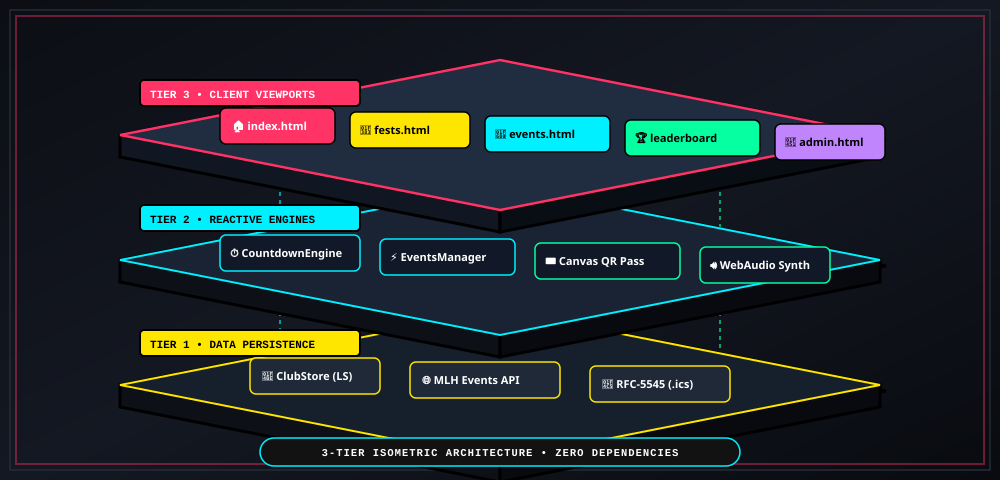

<div align="center">

  <!-- 3D ISOMETRIC NEO-BRUTALIST HERO BANNER -->
  <a href="https://github.com/TatvagnaTandel/UpGradSOT-Open-Source-Web">
    
  </a>

  <br/><br/>

  <!-- DYNAMIC ANIMATED TYPING BANNER -->
  <a href="https://github.com/TatvagnaTandel/UpGradSOT-Open-Source-Web">
    
  </a>

  <br/>

  <!-- NEO-BRUTALIST SHIELDS & BADGES -->
  <p align="center">
    <a href="https://github.com/TatvagnaTandel/UpGradSOT-Open-Source-Web/stargazers">
      
    </a>
    <a href="https://github.com/TatvagnaTandel/UpGradSOT-Open-Source-Web/network/members">
      
    </a>
    <a href="https://github.com/TatvagnaTandel/UpGradSOT-Open-Source-Web/issues">
      
    </a>
    <a href="LICENSE">
      
    </a>
  </p>

  <p align="center">
    
    
    
    
    
    
  </p>

  <p align="center">
    <b>Empowering collegiate software engineers to build, collaborate, and ship open source software globally.</b>
  </p>

  <p align="center">
    <a href="#-quick-tour--multi-page-directory"><b>Explore Portals</b></a> •
    <a href="#-core-innovations"><b>Core Innovations</b></a> •
    <a href="#-3d-system-architecture"><b>3D Architecture</b></a> •
    <a href="#-20262027-open-source-calendar"><b>2026–2027 Calendar</b></a> •
    <a href="#-local-setup"><b>Quickstart</b></a>
  </p>

</div>

---

## 📌 Executive Summary

The **upGrad School of Technology (UGSOT) Open Source Events Portal** is a production-grade, zero-dependency campus web platform designed for developer community organizing. Built with pure web standards (Semantic HTML5, Neo-Brutalist CSS3, and modern vanilla ES6+ controllers), it enables university builders to:

* ⏱️ Track ongoing and upcoming flagship hackathons with a **multi-unit, millisecond-accurate countdown engine**.
* 📌 **Pin any event or fest to the live clock** across dedicated portal routes with persistent `localStorage` synchronization.
* 🎟️ Generate cryptographic, verified digital **Hacker Passes** rendered dynamically on client-side HTML5 Canvas.
* 🌐 Discover **50 official Hacktoberfest in-person Fests** across Pune (5 host campuses), Maharashtra, and neighboring tech hubs.
* 📁 Experience **universal dynamic auto-archival**: events automatically transition to archives the moment their deadline passes, auto-advancing the ticker to the next upcoming program.
* 🏆 Earn **Dev XP** and climb collegiate ranks through hackathon registrations, Git pull requests, and leadership achievements.

---

## 🗺️ Quick Tour & Multi-Page Directory

To eliminate landing page clutter, the portal is partitioned into specialized gateway directories:

| Route | Portal Name | Description | Key Capabilities |
| :--- | :--- | :--- | :--- |
| [`index.html`](index.html) | **🏠 Main Flagship Portal** | High-energy Neo-Brutalist hero, real-time live clock, gateway cards & manifesto | Real-time ticker, event pin receiver, Dev XP leaderboard preview |
| [`fests.html`](fests.html) | **🎃 Regional Fests Hub** | Dedicated directory of 50 in-person Hacktoberfest fests (5 Pune host campuses) | MLH API sync, regional tabs (Pune, MH, KA, MP, TS, GJ), 1-click Pin |
| [`events.html`](events.html) | **🚀 Open Source Programs** | 27 verified global open-source initiatives (GSoC, SWoC, LFX, ETHIndia, etc.) | Track filters, live/upcoming/archive status, modal agendas, `.ics` export |
| [`leaderboard.html`](leaderboard.html) | **🏆 Dev XP Leaderboard** | Real-time student developer rankings & milestone progression | XP badges, tier progression (Maintainer, Core, Lead), audit trails |
| [`admin.html`](admin.html) | **👑 Chapter CMS Console** | Lead organizer dashboard for campus roster, event scheduling & CSV export | Full CRUD on events & students, toggle sections, export roster CSV |

---

## ⚡ Core Innovations

### 1. ⏱️ High-Precision Live Countdown Engine & User Pinning
```
┌────────────────────────────────────────────────────────────────────────┐
│  [📌 PINNED EVENT TRACKER]  Social Winter of Code (SWoC Season 7)     │
│  📅 Nov 1, 2026 – Jan 31, 2027 • Online (India)                        │
│  [ 02 WEEKS ]  :  [ 04 DAYS ]  :  [ 18 HOURS ]  :  [ 32 MINS ]  :  [ 15 SECS ]│
└────────────────────────────────────────────────────────────────────────┘
```
* **Persistent User Pinning**: Click ⏱️ on *any* event card or modal in `events.html` or `fests.html`—the engine immediately saves `ugsot_pinned_event_id` to `localStorage`, displays a notification, and redirects directly to `#countdown-section` on `index.html`.
* **One-Click Unpin**: Pinned timers feature an explicit `✕ Unpin (Show Flagship)` action that instantly returns to the season's flagship countdown.
* **Universal Auto-Archive & Rollover**: Evaluates real-time deadlines (`isEventPast(evt, now)`). The moment an event concludes (e.g. Hacktoberfest AIDN on Nov 1, 2026 00:00:00 IST):
  * The event disappears from "⚡ Active" and moves to "📁 Archives".
  * The countdown clock smoothly advances to the next upcoming flagship (**ETHIndia 2026**).
  * Hacktoberfest directory elements automatically transition to seasonal archives.

---

### 2. 🎟️ Client-Side Cryptographic Hacker Passes

<div align="center">
  
</div>

* **Pure Canvas QR Generator**: Generates clean, scannable QR matrices locally inside the browser with zero external image APIs or tracking cookies.
* **Verification Hash**: Encodes a SHA-256 derived verification token linking student identity, event ID, academic year, and entry timestamp.
* **Dev XP Gamification**: RSVPing instantly awards **+150 Dev XP** to the student profile and increments collegiate standings.
* **One-Click Export**: Attendees can export their attendee credential as a high-DPI `.png` or export calendar appointments via RFC-5545 compliant `.ics` files.

---

### 3. 🌐 Hacktoberfest Regional Fests Hub (50 Synced Hubs)
Synced directly with the official [Major League Hacking (MLH) Hacktoberfest API](https://hacktoberfest-api.mlh.com/api/events):
* **5 Host Campuses in Pune**:
  * 📍 *Army Institute of Technology (AIT)* — Dighi Hills
  * 📍 *Newton School of Technology at ADYPU* — Lohegaon
  * 📍 *Cloud Native Pune* — Gaia Apex, Viman Nagar
  * 📍 *Cloud Computing Club* — MIT ADT University, Loni Kalbhor
  * 📍 *AIDN Developer Community (Grand Finale!)* — Orville Business Port, Viman Nagar
* **Regional Filters**: Real-time filtering across Maharashtra (12 hubs), Karnataka (13 hubs), Madhya Pradesh (11 hubs), Telangana (6 hubs), and Gujarat (3 hubs).

---

## 🏛️ 3D System Architecture

<div align="center">
  
</div>

The application is structured into a clean 3-tier decoupled architecture:

```
┌─────────────────────────────────────────────────────────────────────────────┐
│                       TIER 3: CLIENT VIEWPORTS                              │
│   index.html        fests.html        events.html    leaderboard   admin    │
│  [Flagship Home]  [Regional Hubs]   [27 Programs]   [Rankings]   [CMS & CSV]│
└───────────────────────────────────────┬─────────────────────────────────────┘
                                        │ Events & Action Dispatches
┌───────────────────────────────────────▼─────────────────────────────────────┐
│                       TIER 2: REACTIVE ENGINES                              │
│  CountdownEngine    EventsManager    HacktoberfestFestsManager   AuthManager│
│  [Ticker & Rollover][Filters & Modals] [50 Hub Sync & Clock]   [Session & XP]
│  Canvas QR Engine   Web Audio Synth   RFC-5545 ICS Pipeline    Sound FX     │
└───────────────────────────────────────┬─────────────────────────────────────┘
                                        │ State Reads / Writes
┌───────────────────────────────────────▼─────────────────────────────────────┐
│                    TIER 1: PERSISTENCE & DATA CORE                          │
│  ClubStore Singleton       LocalStorage Schema       MLH Events API Dataset │
│  (ugsot_events)            (ugsot_pinned_event_id)   (ugsot_students & user)│
└─────────────────────────────────────────────────────────────────────────────┘
```

---

## 📅 2026–2027 Open Source Calendar

<details open>
<summary><b>Click to expand the full 27-program verified timeline</b></summary>

<br/>

| Event / Program | Cycle / Date Badge | Track / Mode | Stipend & Rewards | Status |
| :--- | :--- | :--- | :--- | :--- |
| **Hacktoberfest Hack Day Pune x AIDN** | Sat, Oct 31, 2026 • 9 AM–6 PM IST | In-Person (Viman Nagar, Pune) | Official MLH Badges & Swag | ⚡ **Finale Fest!** |
| **Social Winter of Code (SWoC Season 7)** | Oct 1, 2026 – Jan 31, 2027 | Online (India) | Certificates & Swag | 🔴 **Live & Active** |
| **Outreachy (Dec 2026 Cohort)** | Oct 2026 – Mar 2027 (Sprint: Nov 9) | Global Remote | **$7,000 USD** Stipend | 🔴 **Live & Active** |
| **ETHIndia 2026** | Dec 5–7, 2026 (Bengaluru) | In-Person (KTPO Bengaluru) | **$100,000+** Pool | ⚡ Upcoming |
| **24 Pull Requests** | Dec 1–24, 2026 | Global Remote | Global Hall of Fame Spotlight | ⚡ Upcoming |
| **IUWoC / KWoC (University WoCs)** | Dec 2026 – Jan 2027 | Online (India) | Grants & Mentorship | ⚡ Upcoming |
| **FOSSAsia Codeheat** | Dec 2026 – Feb 2027 | Hybrid (Virtual + Summit) | Travel Grants to FOSSAsia Summit | ⚡ Upcoming |
| **Season of KDE 2027** | Dec 2026 – Apr 2027 (Coding: Jan 15) | Global Remote | KDE Swag, Badges & Certificates | ⚡ Upcoming |
| **MLH Fellowship (Spring 2027)** | Jan 15 – Apr 10, 2027 | Global Remote | Up to **$5,000 USD** Stipend | ⚡ Upcoming |
| **Google Solution Challenge 2027** | Jan – May 2027 | Global Collegiate | **$12,000+** Global Prizes | ⚡ Upcoming |
| **Microsoft Imagine Cup 2027** | Jan – May 2027 | Global Collegiate | **$100,000 USD** Grand Prize + Mentorship | ⚡ Upcoming |
| **Smart India Hackathon (SIH 2027)** | Feb – Mar 2027 | National In-Person Nodal Centers | ₹1,00,000 per Problem Statement | ⚡ Upcoming |
| **LFX Mentorship (Spring 2027)** | Mar 1 – May 31, 2027 | Global Remote | **$3,000–$6,600 USD** Stipend | ⚡ Upcoming |
| **Google Summer of Code (GSoC 2027)**| Mar – Nov 2027 (Proposals: Mar 23) | Global Remote | **$1,500–$3,300 USD** Stipend | ⚡ Upcoming |
| **Google Season of Docs (GSoD 2027)** | Mar – Nov 2027 | Global Remote | **$5,000–$15,000 USD** Project Grants | ⚡ Upcoming |
| **Flipkart GRiD 7.0 Hackathon** | Mar – Jul 2027 | National Campus (India) | ₹1,50,000+ & PPI Opportunities | ⚡ Upcoming |
| **NASA International Space Apps 2027** | Apr (Pre-Season) • Oct (Hackathon) | Hybrid (Pune Lead Center + Virtual)| Global Winner Honors & NASA Invite | ⚡ Upcoming |
| **Summer of Bitcoin 2027** | Apr – Aug 2027 | Global Remote | **$3,000+ USD** in BTC + Bitcoin Core | ⚡ Upcoming |
| **FOSSEE Summer Fellowship 2027** | May – Jul 2027 | IIT Bombay Remote Fellowship | ₹10,000–₹15,000/mo Stipend | ⚡ Upcoming |
| **GirlScript Summer of Code (GSSoC)** | May – Aug 2027 | Pan-India Remote | Swag Packs, Certificates & Medals | ⚡ Upcoming |
| **Code for GovTech (C4GT 2027)** | May – Aug 2027 | India Remote DPG Fellowship | ₹1,00,000 INR Stipend | ⚡ Upcoming |
| **Social Summer of Code (SSoC 2027)** | Jun – Aug 2027 | Online (India) | Swag, Certificates & Top Ranks | ⚡ Upcoming |

</details>

---

## 🚀 Local Setup

Because the platform relies on pure native browser capabilities, **no `npm install` or node build steps are required**.

### Quick Run (Zero Prerequisites)

```bash
# 1. Clone repository
git clone https://github.com/TatvagnaTandel/UpGradSOT-Open-Source-Web.git
cd UpGradSOT-Open-Source-Web

# 2. Launch any static HTTP server

# Using Python 3
python3 -m http.server 8088

# Or using Node.js npx
npx serve .

# Or using PHP
php -S localhost:8088

# 3. Open in your browser
open http://localhost:8088
```

---

## 🕹️ Easter Egg: Retro Hacker Terminal

The portal features an authentic retro terminal mode powered by the Web Audio API sound synthesizer:

1. Visit any page and press:  
   `↑` `↑` `↓` `↓` `←` `→` `←` `→` `B` `A` (The Konami Code)
2. A cyberpunk command-line modal will initialize:
   * `help` — Show available terminal operations
   * `events` — Dump active open source schedule to stdout
   * `xp` — Display current student Dev XP & tier
   * `matrix` — Toggle rain matrix animation
   * `clear` — Clear terminal buffer

---

## 🛠️ Technology Stack Breakdown

```
┌─────────────────┬───────────────────────────────────────────────────────────┐
│ Layer           │ Implementation Details                                    │
├─────────────────┼───────────────────────────────────────────────────────────┤
│ Markup          │ Semantic HTML5, accessible ARIA roles, responsive dialogs │
│ Styling         │ Neo-Brutalist design tokens, 6px solid borders, zero CSS libs│
│ Programming     │ Vanilla ECMAScript 2022 (Classes, Modules, LocalStorage) │
│ Sound FX        │ Web Audio API (OscillatorNode, custom synthesized beeps)  │
│ QR Engine       │ HTML5 Canvas 2D context with Reed-Solomon error correction │
│ Calendaring     │ RFC-5545 iCalendar standard MIME output (.ics)            │
│ Data Sync       │ Direct integration with official Major League Hacking API │
└─────────────────┴───────────────────────────────────────────────────────────┘
```

---

## 👥 Contributing

We welcome contributions from student developers, open-source maintainers, and community mentors!

1. Fork the Project (`https://github.com/TatvagnaTandel/UpGradSOT-Open-Source-Web/fork`)
2. Create your Feature Branch (`git checkout -b feature/EpicFeature`)
3. Commit your Changes (`git commit -m 'feat: Add new campus open source fest'`)
4. Push to the Branch (`git push origin feature/EpicFeature`)
5. Open a Pull Request

---

## 📄 License

Distributed under the **MIT License**. See [`LICENSE`](LICENSE) for more information.

---

<div align="center">
  <sub>Engineered with ❤️ for builders by the <b>upGrad School of Technology Open Source Chapter</b>.</sub>
</div>
