<div align="center">

  <!-- 3D ISOMETRIC NEO-BRUTALIST HERO BANNER -->
  <a href="https://github.com/TatvagnaTandel/UpGradSOT-Open-Source-Web">
    
  </a>

  <br/><br/>

  <!-- DYNAMIC ANIMATED TYPING BANNER (LOCAL SELF-CONTAINED SVG) -->
  <a href="https://github.com/TatvagnaTandel/UpGradSOT-Open-Source-Web">
    
  </a>

  <br/><br/>

  <!-- NEO-BRUTALIST SHIELDS & BADGES -->
  <p align="center">
    <a href="https://github.com/TatvagnaTandel/UpGradSOT-Open-Source-Web/stargazers">
      
    </a>
    <a href="https://github.com/TatvagnaTandel/UpGradSOT-Open-Source-Web/network/members">
      
    </a>
    <a href="https://github.com/TatvagnaTandel/UpGradSOT-Open-Source-Web/issues">
      
    </a>
    <a href="LICENSE">
      
    </a>
  </p>

  <p align="center">
    
    
    
    
    
    
    
    
  </p>

  <p align="center">
    <b>Empowering collegiate software engineers to build, collaborate, and ship open source software globally.</b>
  </p>

  <p align="center">
    <a href="#quick-tour--multi-page-directory"><b>Explore Portals</b></a> &bull;
    <a href="#threejs-webgl--gsap-motion-architecture"><b>3D WebGL &amp; GSAP</b></a> &bull;
    <a href="#core-innovations"><b>Core Innovations</b></a> &bull;
    <a href="#3d-system-architecture"><b>Architecture</b></a> &bull;
    <a href="#20262027-open-source-calendar"><b>2026-2027 Calendar</b></a> &bull;
    <a href="#local-setup"><b>Quickstart</b></a>
  </p>

</div>

---

## Executive Summary

The **upGrad School of Technology (UGSOT) Open Source Events Portal** is a production-grade, zero-dependency campus web platform designed for developer community organizing. Built with pure web standards (Semantic HTML5, Neo-Brutalist CSS3, Three.js r128, WebGL 2.0, GSAP 3.12, and modern vanilla ES6+ controllers), it enables university builders to:

* **Interactive 3D WebGL Viewport**: Engage with a real-time, hardware-accelerated 3D coordinate hero scene powered by Three.js and WebGL 2.0, complete with raycasting hover physics, orbital rings, and cyber plane geometry.
* **Physics-Driven Motion**: Experience GSAP 3.12 3D perspective card tilt with specular glare, spring-ticking countdown digit transitions, and coordinated viewport entrance choreographies.
* **Holographic 3D Pass Viewer**: Inspect digital credentials in full 360-degree WebGL rotation with dynamic HTML5 Canvas textures, holographic iridescent specular lighting, and cryptographic SHA-256 validation.
* **Flagship Tracking**: Track ongoing and upcoming flagship hackathons with a multi-unit, millisecond-accurate countdown engine.
* **Persistent Pinning**: Pin any event or fest to the live clock across dedicated portal routes with persistent `localStorage` synchronization.
* **Regional Hubs**: Discover 50 official Hacktoberfest in-person Fests across Pune (5 host campuses), Maharashtra, and neighboring tech hubs.
* **Dynamic Auto-Archival**: Universal lifecycle evaluation transitions events to archives the moment their deadline passes, auto-advancing the ticker to the next upcoming program.
* **Dev XP Progression**: Earn Dev XP and climb collegiate ranks through hackathon registrations, Git pull requests, and leadership achievements.

---

## Quick Tour & Multi-Page Directory

To eliminate landing page clutter, the portal is partitioned into specialized gateway directories:

| Route | Portal Name | Description | Key Capabilities |
| :--- | :--- | :--- | :--- |
| [`index.html`](index.html) | **Main Flagship Portal** | Interactive Three.js WebGL hero, live clock, 3D lab, gateway cards & manifesto | Real-time 3D ticker, event pin receiver, Dev XP leaderboard preview |
| [`fests.html`](fests.html) | **Regional Fests Hub** | Dedicated directory of 50 in-person Hacktoberfest fests (5 Pune host campuses) | MLH API sync, regional tabs (Pune, MH, KA, MP, TS, GJ), 1-click Pin |
| [`events.html`](events.html) | **Open Source Programs** | 27 verified global open-source initiatives (GSoC, SWoC, LFX, ETHIndia, etc.) | Track filters, live/upcoming/archive status, modal agendas, `.ics` export |
| [`leaderboard.html`](leaderboard.html) | **Dev XP Leaderboard** | Real-time student developer rankings & milestone progression | XP badges, tier progression (Maintainer, Core, Lead), audit trails |
| [`admin.html`](admin.html) | **Chapter CMS Console** | Lead organizer dashboard for campus roster, event scheduling & CSV export | Full CRUD on events & students, toggle sections, export roster CSV |

---

## Three.js, WebGL & GSAP Motion Architecture

The portal pairs high-contrast Neo-Brutalist graphic identity with modern GPU-accelerated graphics and physics-driven motion pipelines:

### 1. Hardware-Accelerated Hero Viewport (`js/three-hero.js`)
* **Three.js r128 & WebGL 2.0 Scene Graph**:
  * **Centerpiece Compound**: A dual-shell rotating structure combining an outer wireframe Icosahedron (`THREE.IcosahedronGeometry(2.1)`), an inner faceted core (`THREE.MeshPhongMaterial` with flat shading), and an active pulsating Dev XP seed.
  * **Neo-Brutalist Satellite Cubes**: 6 floating cubes with bold face colors (`#ffe600`, `#ff3366`, `#00f0ff`, `#05ffa1`, `#c084fc`, `#ff6b4a`) outlined with high-contrast black edges (`THREE.EdgesGeometry` + `THREE.LineBasicMaterial`).
  * **Cyber Grid Plane**: An undulating 3D coordinate floor (`THREE.GridHelper`) responding dynamically to scene lighting.
  * **Particle Constellation**: 180 floating node particles with custom vertex color buffers drifting in 3D WebGL space.
* **Interactive Physics & Raycasting**:
  * Mouse coordinate normalization translates cursor position into smooth camera parallax damping (`lerp`).
  * Raycasting detects cursor intersection over floating 3D cubes, triggering a GSAP spring expansion and updating HUD status telemetry in real-time.
  * Energy-conserving `IntersectionObserver` automatically halts the render loop when the hero viewport is scrolled off-screen or the browser tab is hidden.

### 2. GSAP 3.12 Physics & 3D Perspective Card Tilt (`js/gsap-effects.js`)
* **Euler / Quaternion 3D Card Tilt**:
  * Cards (`.countdown-container-card`, `.gateway-card`, `.event-card`, `.fest-card`) track local cursor offsets and map coordinates to dynamic `rotateY` and `rotateX` values under `transformPerspective: 1000`.
  * Dynamic specular glare layers (`.card-glare-overlay`) shift radial gradients in real time with the virtual light angle.
  * Elastic ease (`elastic.out(1, 0.4)`) snaps cards back into baseline equilibrium on mouse leave.
* **Countdown Digit Spring Physics**:
  * DOM MutationObservers detect unit updates on `#timer-seconds`, `#timer-minutes`, `#timer-hours`, and `#timer-weeks`, firing `gsap.fromTo(el, { scale: 1.25, color: '#ff3366' }, { scale: 1, duration: 0.35, ease: 'back.out(2)' })`.
* **Staggered Viewport Entrance**:
  * Smooth page-load sequence coordinates hero badge, split title, call-to-action buttons, and the Three.js viewport into a single cohesive entrance timeline.

### 3. Interactive 3D Holographic Hacker Pass Viewer (`js/three-pass-viewer.js`)
* **Dynamic WebGL Texture Mapping**:
  * Generates a high-resolution 512x740 off-screen canvas rendering attendee identity, dynamic QR code matrix, and cryptographic SHA-256 verification token.
  * Maps the canvas onto the front face of a 3D extruded lanyard card (`THREE.BoxGeometry(2.2, 3.2, 0.06)`).
* **Metallic Holographic Specular Shading**:
  * Dual colored directional lights (neon cyan `#00f0ff` and neon magenta `#ff3366`) create iridescent reflections as the badge tilts.
  * Reverse face displays a brushed dark metallic finish with the collegiate chapter security seal.
  * Interactive 360-degree drag rotation with inertia damping allows attendees to inspect their pass from every angle in full 3D.

### 4. Interactive 3D WebGL Lab Viewport (`js/three-lab.js`)
* Real-time geometry inspection viewport allowing collegiate hackers to toggle between complex geometries (Torus Knot, Dodecahedron Trophy, Icosahedron Wireframe) with GSAP scale bursts and vertex lighting.

---

## Core Innovations

### 1. High-Precision Live Countdown Engine & User Pinning

```
┌────────────────────────────────────────────────────────────────────────┐
│  [PINNED EVENT TRACKER]  Social Winter of Code (SWoC Season 7)         │
│  Nov 1, 2026 – Jan 31, 2027 • Online (India)                           │
│  [ 02 WEEKS ]  :  [ 04 DAYS ]  :  [ 18 HOURS ]  :  [ 32 MINS ]  :  [ 15 SECS ]│
└────────────────────────────────────────────────────────────────────────┘
```

* **Persistent User Pinning**: Click the pin button on *any* event card or modal in `events.html` or `fests.html`—the engine immediately saves `ugsot_pinned_event_id` to `localStorage`, displays a notification, and redirects directly to `#countdown-section` on `index.html`.
* **One-Click Unpin**: Pinned timers feature an explicit `Unpin (Show Flagship)` action that instantly returns to the season's flagship countdown.
* **Universal Auto-Archive & Rollover**: Evaluates real-time deadlines (`isEventPast(evt, now)`). The moment an event concludes (e.g. Hacktoberfest AIDN on Nov 1, 2026 00:00:00 IST):
  * The event disappears from "Active" and moves to "Archives".
  * The countdown clock smoothly advances to the next upcoming flagship (**ETHIndia 2026**).
  * Hacktoberfest directory elements automatically transition to seasonal archives.

---

### 2. Client-Side Cryptographic Hacker Passes

<div align="center">
  
</div>

* **Interactive 3D WebGL & 2D Pass Modes**: Attendees can switch between printable high-resolution 2D tickets and full 360-degree interactive Three.js 3D Holographic passes.
* **Pure Canvas QR Generator**: Generates clean, scannable QR matrices locally inside the browser with zero external image APIs or tracking cookies.
* **Verification Hash**: Encodes a SHA-256 derived verification token linking student identity, event ID, academic year, and entry timestamp.
* **Dev XP Gamification**: RSVPing instantly awards **+150 Dev XP** to the student profile and increments collegiate standings.
* **One-Click Export**: Attendees can export their attendee credential as a high-DPI `.png` or export calendar appointments via RFC-5545 compliant `.ics` files.

---

### 3. Hacktoberfest Regional Fests Hub (50 Synced Hubs)

Synced directly with the official [Major League Hacking (MLH) Hacktoberfest API](https://hacktoberfest-api.mlh.com/api/events):

* **5 Host Campuses in Pune**:
  * *Army Institute of Technology (AIT)* — Dighi Hills
  * *Newton School of Technology at ADYPU* — Lohegaon
  * *Cloud Native Pune* — Gaia Apex, Viman Nagar
  * *Cloud Computing Club* — MIT ADT University, Loni Kalbhor
  * *AIDN Developer Community (Grand Finale)* — Orville Business Port, Viman Nagar
* **Regional Filters**: Real-time filtering across Maharashtra (12 hubs), Karnataka (13 hubs), Madhya Pradesh (11 hubs), Telangana (6 hubs), and Gujarat (3 hubs).

---

## 3D System Architecture

<div align="center">
  
</div>

The application is structured into a clean 3-tier decoupled architecture:

```
┌─────────────────────────────────────────────────────────────────────────────┐
│                       TIER 3: CLIENT VIEWPORTS                              │
│   index.html        fests.html        events.html    leaderboard   admin    │
│  [Flagship Home]  [Regional Hubs]   [27 Programs]   [Rankings]   [CMS & CSV]│
└───────────────────────────────────────┬─────────────────────────────────────┘
                                        │ Events & Action Dispatches
┌───────────────────────────────────────▼─────────────────────────────────────┐
│                       TIER 2: REACTIVE ENGINES                              │
│  Three.js 3D Scene  WebGL 2.0 Engine  GSAP 3 Timelines  CountdownEngine     │
│  [Hero & 3D Lab]    [Hardware Shaders][Card Tilt & Pop] [Ticker & Rollover] │
│  Canvas QR Engine   Web Audio Synth   RFC-5545 ICS      Auth & XP Manager   │
└───────────────────────────────────────┬─────────────────────────────────────┘
                                        │ State Reads / Writes
┌───────────────────────────────────────▼─────────────────────────────────────┐
│                    TIER 1: PERSISTENCE & DATA CORE                          │
│  ClubStore Singleton       LocalStorage Schema       MLH Events API Dataset │
│  (ugsot_events)            (ugsot_pinned_event_id)   (ugsot_students & user)│
└─────────────────────────────────────────────────────────────────────────────┘
```

---

## 2026-2027 Open Source Calendar

<details open>
<summary><b>Click to expand the full 27-program verified timeline</b></summary>

<br/>

| Event / Program | Cycle / Date Badge | Track / Mode | Stipend & Rewards | Status |
| :--- | :--- | :--- | :--- | :--- |
| **Hacktoberfest Hack Day Pune x AIDN** | Sat, Oct 31, 2026 • 9 AM–6 PM IST | In-Person (Viman Nagar, Pune) | Official MLH Badges & Swag | **Finale Fest** |
| **Social Winter of Code (SWoC Season 7)** | Oct 1, 2026 – Jan 31, 2027 | Online (India) | Certificates & Swag | **Live & Active** |
| **Outreachy (Dec 2026 Cohort)** | Oct 2026 – Mar 2027 (Sprint: Nov 9) | Global Remote | **$7,000 USD** Stipend | **Live & Active** |
| **ETHIndia 2026** | Dec 5–7, 2026 (Bengaluru) | In-Person (KTPO Bengaluru) | **$100,000+** Pool | Upcoming |
| **24 Pull Requests** | Dec 1–24, 2026 | Global Remote | Global Hall of Fame Spotlight | Upcoming |
| **IUWoC / KWoC (University WoCs)** | Dec 2026 – Jan 2027 | Online (India) | Grants & Mentorship | Upcoming |
| **FOSSAsia Codeheat** | Dec 2026 – Feb 2027 | Hybrid (Virtual + Summit) | Travel Grants to FOSSAsia Summit | Upcoming |
| **Season of KDE 2027** | Dec 2026 – Apr 2027 (Coding: Jan 15) | Global Remote | KDE Swag, Badges & Certificates | Upcoming |
| **MLH Fellowship (Spring 2027)** | Jan 15 – Apr 10, 2027 | Global Remote | Up to **$5,000 USD** Stipend | Upcoming |
| **Google Solution Challenge 2027** | Jan – May 2027 | Global Collegiate | **$12,000+** Global Prizes | Upcoming |
| **Microsoft Imagine Cup 2027** | Jan – May 2027 | Global Collegiate | **$100,000 USD** Grand Prize + Mentorship | Upcoming |
| **Smart India Hackathon (SIH 2027)** | Feb – Mar 2027 | National In-Person Nodal Centers | ₹1,00,000 per Problem Statement | Upcoming |
| **LFX Mentorship (Spring 2027)** | Mar 1 – May 31, 2027 | Global Remote | **$3,000–$6,600 USD** Stipend | Upcoming |
| **Google Summer of Code (GSoC 2027)**| Mar – Nov 2027 (Proposals: Mar 23) | Global Remote | **$1,500–$3,300 USD** Stipend | Upcoming |
| **Google Season of Docs (GSoD 2027)** | Mar – Nov 2027 | Global Remote | **$5,000–$15,000 USD** Project Grants | Upcoming |
| **Flipkart GRiD 7.0 Hackathon** | Mar – Jul 2027 | National Campus (India) | ₹1,50,000+ & PPI Opportunities | Upcoming |
| **NASA International Space Apps 2027** | Apr (Pre-Season) • Oct (Hackathon) | Hybrid (Pune Lead Center + Virtual)| Global Winner Honors & NASA Invite | Upcoming |
| **Summer of Bitcoin 2027** | Apr – Aug 2027 | Global Remote | **$3,000+ USD** in BTC + Bitcoin Core | Upcoming |
| **FOSSEE Summer Fellowship 2027** | May – Jul 2027 | IIT Bombay Remote Fellowship | ₹10,000–₹15,000/mo Stipend | Upcoming |
| **GirlScript Summer of Code (GSSoC)** | May – Aug 2027 | Pan-India Remote | Swag Packs, Certificates & Medals | Upcoming |
| **Code for GovTech (C4GT 2027)** | May – Aug 2027 | India Remote DPG Fellowship | ₹1,00,000 INR Stipend | Upcoming |
| **Social Summer of Code (SSoC 2027)** | Jun – Aug 2027 | Online (India) | Swag, Certificates & Top Ranks | Upcoming |

</details>

---

## Local Setup

Because the platform relies on pure native browser capabilities with bundled vendor runtimes, **no `npm install` or node build steps are required**.

### Quick Run (Zero Prerequisites)

```bash
# 1. Clone repository
git clone https://github.com/TatvagnaTandel/UpGradSOT-Open-Source-Web.git
cd UpGradSOT-Open-Source-Web

# 2. Launch any static HTTP server

# Using Python 3
python3 -m http.server 8088

# Or using Node.js npx
npx serve .

# Or using PHP
php -S localhost:8088

# 3. Open in your browser
open http://localhost:8088
```

---

## Retro Hacker Terminal (Easter Egg)

The portal features an authentic retro terminal mode powered by the Web Audio API sound synthesizer:

1. Visit any page and press:  
   `↑` `↑` `↓` `↓` `←` `→` `←` `→` `B` `A` (The Konami Code)
2. A cyberpunk command-line modal will initialize:
   * `help` — Show available terminal operations
   * `events` — Dump active open source schedule to stdout
   * `xp` — Display current student Dev XP & tier
   * `matrix` — Toggle rain matrix animation
   * `clear` — Clear terminal buffer

---

## Technology Stack Breakdown

```
┌─────────────────┬───────────────────────────────────────────────────────────┐
│ Layer           │ Implementation Details                                    │
├─────────────────┼───────────────────────────────────────────────────────────┤
│ 3D Rendering    │ Three.js r128, WebGL 2.0 context, custom Phong materials  │
│ Motion & Physics│ GSAP 3.12 (Timelines, 3D Perspective Tilt, Elastic Ease)  │
│ Markup          │ Semantic HTML5, accessible ARIA roles, responsive dialogs │
│ Styling         │ Neo-Brutalist design tokens, 6px solid borders, CSS3 vars │
│ Programming     │ Vanilla ECMAScript 2022 (Classes, Modules, LocalStorage) │
│ Sound FX        │ Web Audio API (OscillatorNode, custom synthesized beeps)  │
│ QR Engine       │ HTML5 Canvas 2D context with Reed-Solomon error correction │
│ Calendaring     │ RFC-5545 iCalendar standard MIME output (.ics)            │
│ Data Sync       │ Direct integration with official Major League Hacking API │
└─────────────────┴───────────────────────────────────────────────────────────┘
```

---

## Contributing

We welcome contributions from student developers, open-source maintainers, and community mentors:

1. Fork the Project (`https://github.com/TatvagnaTandel/UpGradSOT-Open-Source-Web/fork`)
2. Create your Feature Branch (`git checkout -b feature/EpicFeature`)
3. Commit your Changes (`git commit -m 'feat: Add new campus open source fest'`)
4. Push to the Branch (`git push origin feature/EpicFeature`)
5. Open a Pull Request

---

## License

Distributed under the **MIT License**. See [`LICENSE`](LICENSE) for more information.

---

<div align="center">
  <sub>Engineered for builders by the <b>upGrad School of Technology Open Source Chapter</b>.</sub>
</div>
