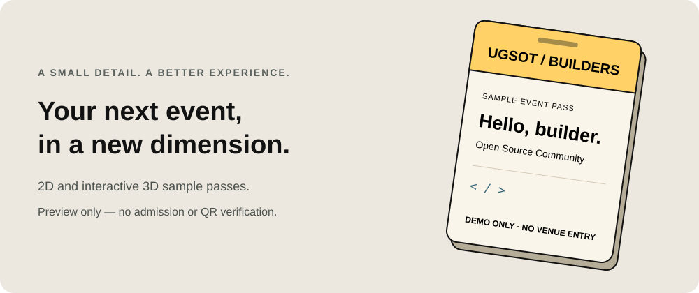
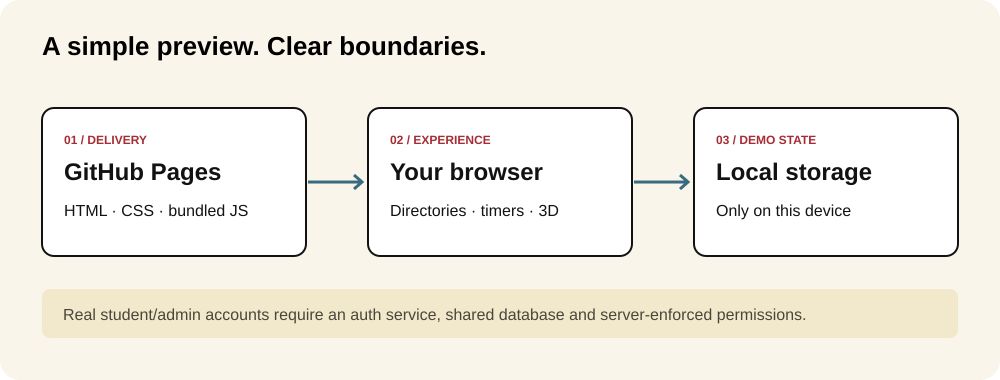

# UGSOT Open Source Events

A student community portal for discovering open-source programs, following event countdowns, and exploring a sample student and organizer experience.

[Visit the GitHub Pages preview](https://tatvagnatandel.github.io/UpGradSOT-Open-Source-Web/) · [Production deployment plan](docs/DEPLOYMENT.md) · [Browser audit](docs/SITE-AUDIT.md)

**Current status: static demo.** Profiles, rankings, RSVPs, admin changes and passes are browser-local samples. There is no connected authentication provider or shared database. Event schedules and rewards are seed content; confirm details on organizers' official sites before applying. The demo does not collect passwords.

## Explore

| Page | What you can try |
| --- | --- |
| [Home](index.html) | Code sculpture, flagship countdown, directory links, geometry playground |
| [Programs](events.html) | Search and filter programs, event details, pin a countdown, calendar export |
| [Regional fests](fests.html) | Browse the seasonal event dataset |
| [Leaderboard](leaderboard.html) | Sample rankings and student profiles |
| [Admin demo](admin.html) | Edit browser-local sample events, sections and roster |

Choose **Explore demo** to try a sample student or admin profile. The admin demo is publicly accessible and must never contain real student records.

## 3D with a purpose

The hero uses a beveled code sculpture with warm materials, neutral lighting, and a stable pedestal. The lab presents one geometry at a time. Both support pointer dragging, keyboard rotation, reset and pause. Controls sit outside the canvas so they remain readable on phones.

- **Arrow keys:** rotate the focused canvas. **Home:** reset. **Space:** pause/resume.
- Reduced-motion preferences disable continuous rotation and decorative motion.
- `IntersectionObserver` and page visibility suspend animation off-screen; `ResizeObserver` fits the full object at every aspect ratio.
- Rendering is capped at 1.5 device pixel ratio. Frames use elapsed time rather than monitor refresh rate.
- WebGL failure leaves a static illustration. Passes fall back to the 2D preview.
- Pass scenes release textures, geometry, materials and listeners when closed or replaced.



Pass codes are decorative patterns, not scannable QR codes. Their reference strings are not signatures. A production pass needs server-issued registration, a real QR encoder and an authenticated check-in service.

## Run locally

Node.js 22 or newer; no dependency installation or frontend build is required.

```sh
git clone https://github.com/TatvagnaTandel/UpGradSOT-Open-Source-Web.git
cd UpGradSOT-Open-Source-Web
npm run dev
```

Open [localhost:8088](http://127.0.0.1:8088). Run `npm test` for lifecycle and demo-session regressions, and `npm run check` for JavaScript syntax, local asset references and duplicate page IDs.

## Structure



```text
index.html / events.html / fests.html / leaderboard.html / admin.html
css/                 Shared layouts, components and 3D presentation
js/three-stage.js    Shared rendering, input, motion and cleanup lifecycle
js/three-hero.js     Code sculpture
js/three-lab.js      Geometry playground
js/three-pass-viewer.js  Sample badge texture and scene
js/store.js          Seed dataset and browser-local demo state
vendor/              Bundled Three.js r128 and GSAP runtimes
assets/              Brand images and self-contained SVG illustrations
docs/                Audit and deployment plan
```

## From demo to a live service

Recommended: keep this frontend, host it on GitHub Pages or Cloudflare Pages, and connect **Supabase Auth + Postgres + Edge Functions**. Enforce student/admin permissions in the database; keep role assignment, admission checks and XP awards on the server. This backend is a planned integration, not included or deployed here.

The [deployment guide](docs/DEPLOYMENT.md) describes the schema, permissions, authentication flow, hosting settings and acceptance checks needed before onboarding real students.

## Project notes

Vendor libraries are bundled; Google Fonts is the remaining external presentation request. The frontend works with system-font fallbacks if fonts cannot load. Local demo data can be cleared with the admin demo's sample reset action. There is currently no repository license grant; preserve upstream vendor notices and add a project license only with the owner's choice.
